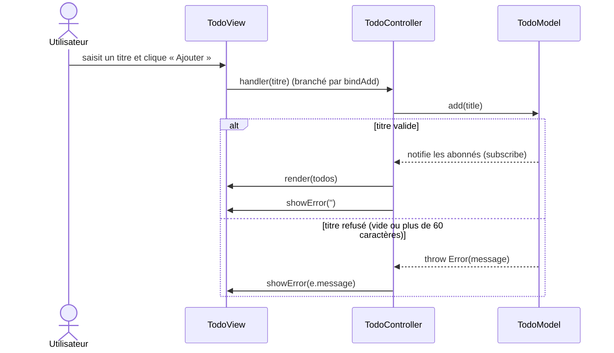
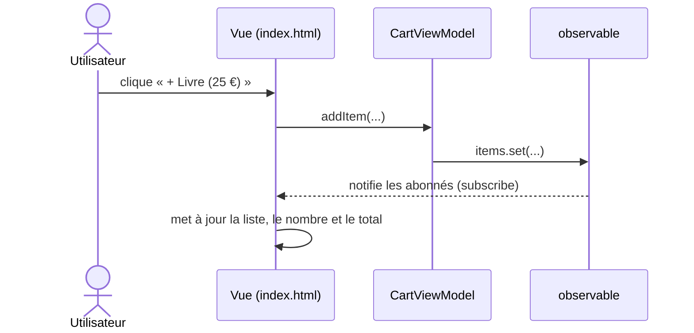

# Séquences MVC / MVP / MVVM

## Étape 1 : observations

| Question | MVC (Todo) | MVP (Connexion) | MVVM (Panier) |
|---|---|---|---|
| Quel fichier reçoit le clic ? | TodoView.js (le formulaire, via bindAdd) | La View, qui transmet au Presenter | index.html (le script appelle les commandes du ViewModel) |
| Quel fichier contient la règle de validation ? | TodoModel.js | LoginPresenter.js | CartViewModel.js |
| Qui met l'écran à jour, et comment ? | Le Controller appelle view.render(...) | Le Presenter appelle les méthodes de la View (showError...) | La vue, abonnée avec subscribe(...), se met à jour toute seule |
| Combien de tests ? Besoin du navigateur ? | 3 tests, sans navigateur | 3 tests, sans navigateur | 2 tests, sans navigateur |

## Étape 2 : diagramme MVC (ajouter une tâche)

## Étape 2 : diagramme MVVM (ajouter un article)

## Différence principale

En MVC, le Controller est un intermédiaire actif : il reçoit l'action de la View, appelle le Model, puis demande à la View de se redessiner. En MVVM, la vue s'abonne aux valeurs observables du ViewModel et se met à jour toute seule, sans que le ViewModel connaisse la vue.

## Étape 3 : pourquoi le message s'affiche sans toucher à la View ni au Controller

Dans TodoController.js, bindAdd appelle model.add(title) à l'intérieur d'un try / catch. Quand TodoModel.add lance l'erreur « 60 caractères maximum », le catch la récupère et appelle view.showError(e.message) : le message s'affiche sans avoir modifié la View ni le Controller, car le chemin d'erreur existait déjà pour le titre vide.# Séquences MVC / MVP / MVVM

## Étape 1 : observations

| Question | MVC (Todo) | MVP (Connexion) | MVVM (Panier) |
|---|---|---|---|
| Quel fichier reçoit le clic ? | TodoView.js (le formulaire, via bindAdd) | La View, qui transmet au Presenter | index.html (le script appelle les commandes du ViewModel) |
| Quel fichier contient la règle de validation ? | TodoModel.js | LoginPresenter.js | CartViewModel.js |
| Qui met l'écran à jour, et comment ? | Le Controller appelle view.render(...) | Le Presenter appelle les méthodes de la View (showError...) | La vue, abonnée avec subscribe(...), se met à jour toute seule |
| Combien de tests ? Besoin du navigateur ? | 3 tests, sans navigateur | 3 tests, sans navigateur | 2 tests, sans navigateur |

## Étape 2 : diagramme MVC (ajouter une tâche)

## Étape 2 : diagramme MVVM (ajouter un article)

## Différence principale

En MVC, le Controller est un intermédiaire actif : il reçoit l'action de la View, appelle le Model, puis demande à la View de se redessiner. En MVVM, la vue s'abonne aux valeurs observables du ViewModel et se met à jour toute seule, sans que le ViewModel connaisse la vue.

## Étape 3 : pourquoi le message s'affiche sans toucher à la View ni au Controller

Dans TodoController.js, bindAdd appelle model.add(title) à l'intérieur d'un try / catch. Quand TodoModel.add lance l'erreur « 60 caractères maximum », le catch la récupère et appelle view.showError(e.message) : le message s'affiche sans avoir modifié la View ni le Controller, car le chemin d'erreur existait déjà pour le titre vide.# Séquences MVC / MVP / MVVM

## Étape 1 : observations

| Question | MVC (Todo) | MVP (Connexion) | MVVM (Panier) |
|---|---|---|---|
| Quel fichier reçoit le clic ? | TodoView.js (le formulaire, via bindAdd) | La View, qui transmet au Presenter | index.html (le script appelle les commandes du ViewModel) |
| Quel fichier contient la règle de validation ? | TodoModel.js | LoginPresenter.js | CartViewModel.js |
| Qui met l'écran à jour, et comment ? | Le Controller appelle view.render(...) | Le Presenter appelle les méthodes de la View (showError...) | La vue, abonnée avec subscribe(...), se met à jour toute seule |
| Combien de tests ? Besoin du navigateur ? | 3 tests, sans navigateur | 3 tests, sans navigateur | 2 tests, sans navigateur |

## Étape 2 : diagramme MVC (ajouter une tâche)

## Étape 2 : diagramme MVVM (ajouter un article)

## Différence principale

En MVC, le Controller est un intermédiaire actif : il reçoit l'action de la View, appelle le Model, puis demande à la View de se redessiner. En MVVM, la vue s'abonne aux valeurs observables du ViewModel et se met à jour toute seule, sans que le ViewModel connaisse la vue.

## Étape 3 : pourquoi le message s'affiche sans toucher à la View ni au Controller

Dans TodoController.js, bindAdd appelle model.add(title) à l'intérieur d'un try / catch. Quand TodoModel.add lance l'erreur « 60 caractères maximum », le catch la récupère et appelle view.showError(e.message) : le message s'affiche sans avoir modifié la View ni le Controller, car le chemin d'erreur existait déjà pour le titre vide.Markdown Preview Mermaid SupportMarkdown Preview Mermaid Support